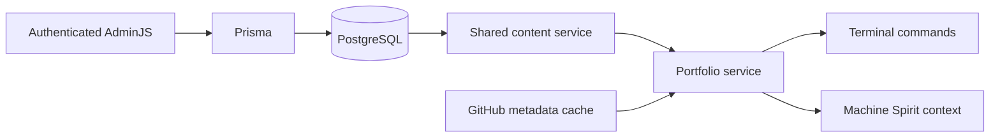

# Content and database implementation

## Content inventory and boundaries

| Content                                                                        | Source and editing                               | Consumers                                             |
| ------------------------------------------------------------------------------ | ------------------------------------------------ | ----------------------------------------------------- | -------------------------------- |
| About, skills, experience, contact                                             | `ContentSection.body`, plain textarea            | Matching terminal commands and Machine Spirit context |
| Interests                                                                      | `ContentSection.body`, plain textarea            | Machine Spirit context; no new terminal command       |
| Selected repositories, display names, visibility, numbers                      | `FeaturedProject` form                           | `projects`, `project <name                            | number>`, Machine Spirit context |
| Repository descriptions, topics, canonical URLs                                | GitHub repository API, never editable CMS fields | Project detail and Machine Spirit project context     |
| Command syntax/help, banners, boot/shutdown, themes, animation, link rendering | Existing client/shared code                      | Terminal behavior                                     |
| AI persona/model, limits, credentials, proxy and environment settings          | Server code/environment                          | Application behavior and configuration                |

The old `shared/data/portfolio.ts` and `shared/data/projects.ts` runtime constants were removed. Their initial content lives only in [initial-content.ts](../server/prisma/initial-content.ts), including interests previously embedded in the context builder. Existing frontend components and styles are unchanged. Contact text remains plain text; the existing terminal safely creates text nodes and HTTP/email links without rendering CMS HTML.

Relevant runtime entry points are [server.ts](../server/server.ts), [app.ts](../server/app.ts), [server-registry.ts](../server/commands/server-registry.ts), [content.ts](../server/services/content.ts), [portfolio.ts](../server/services/portfolio.ts), [github.ts](../server/services/github.ts) and [machine-spirit-context.ts](../server/services/machine-spirit-context.ts).



Each biography section is one text value because its line breaks, headings and lists are presentation content. There is no rich text, Markdown renderer, page builder or unnecessary skill/employer/contact normalization. Projects need structured fields because identity, ordering and visibility must be validated independently. There are no foreign keys: sections, curated repositories and sessions are independent records.

## Schema and PostgreSQL concepts

The authoritative model is [schema.prisma](../server/prisma/schema.prisma). The version-controlled [initial migration](../server/prisma/migrations/20261024072625_initial_portfolio_content/migration.sql) creates:

| Table             | Columns and PostgreSQL types                                                                                                                        | Rules                                                                                                                                                                  |
| ----------------- | --------------------------------------------------------------------------------------------------------------------------------------------------- | ---------------------------------------------------------------------------------------------------------------------------------------------------------------------- |
| `ContentSection`  | `key varchar(32)`, `body text`, `updatedAt timestamptz(3)`                                                                                          | Key is the primary key; CHECK limits keys to about/skills/experience/contact/interests and body to nonempty-after-space-trimming, at most 20,000 PostgreSQL characters |
| `FeaturedProject` | `id text`, `owner varchar(39)`, `repo varchar(100)`, `displayName varchar(120)`, `featured boolean`, `position integer`, `updatedAt timestamptz(3)` | Primary key id; unique owner/repo pair; globally unique position; positive position and canonical identity/name CHECK constraints                                      |
| `admin_session`   | `sid varchar`, `sess json`, `expire timestamp(6)`                                                                                                   | Primary key sid; expiry index; format required by connect-pg-simple                                                                                                    |

All columns are `NOT NULL`. A primary key identifies a record permanently. The project ID is generated by Prisma (`cuid`) for new projects; seed IDs are fixed so later owner/name changes do not cause reseeding duplicates. Unique indexes prevent conflicting writes even when two saves race. The composite owner/repo index distinguishes organizations with identically named repositories. PostgreSQL CHECK constraints reject invalid direct SQL as well as CMS writes. `integer` is a signed 32-bit number; the form accepts 1–2147483647. `text` accommodates multiline prose; `varchar` adds explicit length bounds. `boolean` represents featured/hidden.

`updatedAt` uses timezone-aware timestamps at millisecond precision. Its default is database insertion time; Prisma's `@updatedAt` updates it on ORM writes, not through a database trigger. Session expiry deliberately uses the store's expected timestamp without timezone and session JSON structure; sessions are not an editable AdminJS resource. Its expiry index helps cleanup. Prisma also creates `_prisma_migrations` to track applied SQL and checksums.

Application validation is stricter than SQL in a few places: it rejects all-whitespace text and control characters, preserves ordinary spaces/tabs/newlines, and normalizes CRLF to LF. JavaScript length limits count UTF-16 code units. Project owner/repo are trimmed and lowercased; display names are trimmed, single-line text. Omitted featured on a new form defaults to false. Hidden projects reserve their position. To swap 1 and 2, move 1 to an unused number, move 2 to 1, then move the temporary record to 2. Numbers may have gaps, but **the displayed number is the unique stored position**, so `project 2` always selects at most one displayed project. Duplicate display names are allowed; ambiguous name lookup asks the visitor to use a number. Admin deletion is disabled: hide projects instead.

## Shared reads, caching and failures

Both command handlers and Machine Spirit use the same injected portfolio service. The latter builds current context before calling OpenAI, so a database failure prevents that call. No runtime import reads seed content.

- Section and featured-project lists have separate 30-second in-process caches. A successful AdminJS save invalidates both on that instance immediately, including protection against an older in-flight read repopulating the cache. Another replica or a direct SQL edit becomes visible on its next read after at most 30 seconds. Rerun a terminal command; existing terminal history is not rewritten. An already-running request may finish using its earlier snapshot.
- Missing/blank required sections or unavailable PostgreSQL produce `Portfolio content is temporarily unavailable. Please try again.` and HTTP 503 through the existing terminal output protocol. Failed reads are not cached. Warm content can remain visible only for its remaining TTL; expired values are not served as fallback. The next read retries after recovery. Zero featured projects is valid and produces `No featured projects yet.`
- GitHub calls are keyed by lowercase owner/repo, with a five-minute success cache, 30-second unavailable cache, five-second request timeout, coalesced simultaneous requests and a 200-entry bound. A failed, private or missing repository affects only that record. The display name remains visible with explicit unavailable metadata; other repositories still work. Descriptions, topics and URLs are taken only from GitHub. Listing `projects` requires no GitHub call; project details and full context may call GitHub.
- Plain text is returned verbatim, including blank lines and indentation. Neither service converts prose to HTML. The existing client animation/link handling remains responsible for display.

## Admin integration and security

[resources.ts](../server/admin/resources.ts) registers a thin subclass of the official Prisma adapter. Its constructor receives the model/client/invalidation function together, so AdminJS's resource factory retains the custom save behavior. Action hooks validate raw form payloads and remove immutable IDs/keys **before** AdminJS merges record parameters. Adapter writes validate again, translate uniqueness conflicts into field errors and invalidate caches only after a successful write. JSON and actual browser multipart saves are tested.

All resource actions require an authenticated admin. Only the login page and assets are public; section creation, project/section deletion, bulk deletion and session editing are unavailable. One server-configured account uses a salted scrypt hash and timing-safe comparison. No password, hash, database URL or API key is sent as frontend configuration. Login regenerates the session ID and has a 10-attempt/15-minute per-IP limit. Unsafe admin methods require the exact configured Origin; cross-site logout is rejected. This includes direct admin API requests, not just navigation.

Sessions persist in PostgreSQL using connect-pg-simple, with HttpOnly, SameSite=Lax, eight-hour cookies scoped to `/admin`; production adds Secure. `ADMIN_SESSION_SECRET` must stay stable across redeployments. Rotate it to invalidate existing cookies when rotating compromised credentials. PostgreSQL roles restrict database privileges separately from admin authentication. There is no user management, password reset, MFA or audit-history system in this small single-owner CMS.

## Compatibility verified on 2026-10-24

| Component            | Selection                                                               | Evidence/limitations                                                                                                                                                                                                                                           |
| -------------------- | ----------------------------------------------------------------------- | -------------------------------------------------------------------------------------------------------------------------------------------------------------------------------------------------------------------------------------------------------------- |
| Prisma CLI + Client  | **6.19.3**, pinned together                                             | Latest verified stable Prisma 6 patch; [release notes](https://github.com/prisma/orm/releases/tag/6.19.3) include an `effect` dependency security fix                                                                                                          |
| AdminJS              | **7.8.17**                                                              | ESM-only major; [getting started](https://docs.adminjs.co/installation/getting-started)                                                                                                                                                                        |
| `@adminjs/prisma`    | **5.0.4**                                                               | [Official package metadata](https://github.com/SoftwareBrothers/adminjs-prisma/blob/main/package.json) declares Prisma 5/6 compatibility; [adapter setup](https://docs.adminjs.co/installation/adapters/prisma) uses `prisma-client-js` and explicit resources |
| `@adminjs/express`   | **6.1.1**                                                               | [Official metadata](https://github.com/SoftwareBrothers/adminjs-expressjs/blob/master/package.json) accepts Express >=4.18.2; [authenticated router guide](https://docs.adminjs.co/installation/plugins/express)                                               |
| Express / TypeScript | Existing **5.2.1 / 6.0.3**                                              | Retained and exercised by actual browser/API tests; declaration compatibility needs `skipLibCheck` for third-party AdminJS types, while application strict checks remain on                                                                                    |
| Node                 | **24 LTS**, tested 24.16.0                                              | Package engines also admit 22.12+ in Node 22; ESM + NodeNext and explicit `.js` server imports retained                                                                                                                                                        |
| Sessions             | express-session **1.19.0**, connect-pg-simple **10.0.0**, pg **8.23.1** | PostgreSQL store tested across app restart; its table is created only by migrations                                                                                                                                                                            |

Do not upgrade Prisma to 7 just because it is newer: the selected AdminJS adapter does not declare support. Do not replace this with a Prisma 7 driver-adapter/config recipe. [Prisma 6 PostgreSQL connector documentation](https://www.prisma.io/docs/orm/v6/overview/databases/postgresql) applies here.

Express 5 required deliberate integration details: mount AdminJS before any body parser, restrict `express.json` to `/terminal`, retain AdminJS's multipart parser, and generate assets into non-hidden `server/adminjs-assets` so Express serves them. Startup waits for initialization. The directory is disposable, gitignored and must be writable in the runtime image. No custom React editor or GitHub picker was added.

## Dependency review before public deployment (2026-10-25)

A fresh audit of this root lockfile reports **44 affected package entries** (40 moderate, 4 high, 0 critical). Those are propagated package severities, **not 44 independent bugs**. Deduplicating the advisory IDs yields **13 individual advisories**: five high, six moderate and two low. `npm audit --workspace client` reports zero; the Vite/Web Components site does not import AdminJS. `npm audit --omit=dev` still reports 44 because npm's dependency/peer graph includes the Prisma CLI path. That report alone cannot establish that CLI code runs on HTTP requests.

The current registry versions are AdminJS 7.8.17, design-system 4.1.1, Prisma 6.19.3 and `@adminjs/prisma` 5.0.4. Their published dependency ranges constrain TinyMCE to 5/6, Tiptap to exact 2.1.13, i18next HTTP backend to 2.x, React Router to 6.x, uuid to 9.x, and Prisma config's deepmerge-ts to exact 7.1.5. There is **no patched release within these declared ranges**. `npm audit fix --force` proposes incompatible major changes or AdminJS downgrades. No override or major upgrade was applied.

**High findings first.** `tinymce@6.8.6` arrives through AdminJS → design-system → `@tinymce/tinymce-react`; the design system's optional TinyMCE component separately hardcodes a **6.8.2 CDN script** and enables the media plugin by default. Its four high advisories require crafted HTML to be parsed/restored by that editor. Our AdminJS resource uses a plain `textarea`, and the public terminal uses text nodes, so this configuration does not invoke a TinyMCE editor or the CDN script. The TinyMCE wrapper is included in AdminJS browser assets, which the login page can load before authentication; its separate CDN editor script is fetched only if a TinyMCE field mounts. A rich-text property would expose the vulnerable editor. Authentication limits who can submit content but does not repair an editor XSS affecting a logged-in administrator. [TinyMCE nested SVG](https://github.com/advisories/GHSA-mh5m-5hw4-5c69), [media plugin](https://github.com/advisories/GHSA-vg35-5wq7-3x7w), [unsafe attributes](https://github.com/advisories/GHSA-q742-qvgc-gc2f), [protected comments](https://github.com/advisories/GHSA-v98h-vmpc-fpqv).

`deepmerge-ts@7.1.5` is called by `@prisma/config` when the **Prisma CLI loads the checked-in config** for generation/migrations. The high advisory requires _two cyclic JavaScript objects_ merged along the same path; plain JSON, PostgreSQL rows and ordinary HTTP form values cannot create that graph. The current config is a fixed repo-owned object. We found no runtime request path that invokes the CLI. It may still be installed in a deployment image, which is distinct from being executed by the Express service. Fixing it through upstream dependencies requires Prisma's newer incompatible major; the selected AdminJS adapter declares Prisma 5/6. [DeepmergeTS advisory](https://github.com/advisories/GHSA-ggr8-5vv4-36mx).

**Lower findings with possible browser impact.** AdminJS uses React Router 6 in its browser application. The SSR error-hydration advisory needs Data/Framework Mode manual SSR, while this editor uses BrowserRouter and Express does no React SSR. The open-redirect advisory needs an attacker-controlled path passed to `Link`/`useNavigate` and a victim interaction. Installed AdminJS code also accepts a `redirectUrl` query parameter on its New form's Cancel action. We added a server-side guard that accepts only paths under this origin's `/admin/` and tests external, protocol-relative, backslash, duplicate and array-style values. This closes the observed query-driven Cancel redirect; it does **not** patch the separate React Router advisory. AdminJS API action redirects are generated from resource paths. **Reachability of every other AdminJS navigation branch is uncertain**. [Router redirect](https://github.com/advisories/GHSA-wrjc-x8rr-h8h6), [SSR hydration](https://github.com/advisories/GHSA-337j-9hxr-rhxg).

AdminJS bundles `i18next-http-backend`, but its own initializer enables it only when `withBackend` is true and enables browser language detection only when `localeDetection` is true. We set neither; both default false. The advisories require an attacker-controlled language/namespace interpolated into a load path. We found no such configured endpoint; **other internal dynamic use has not been formally proved absent**. [Path/URL injection](https://github.com/advisories/GHSA-q89c-q3h5-w34g), [later colon bypass](https://github.com/advisories/GHSA-xvq9-wjp8-hwqf).

The Tiptap `mergeAttributes` flaw requires attacker-controlled attributes with an own `__proto__` key entering a rich-text/ProseMirror DOM serializer. Its link flaw requires a malicious `javascript:` link entered through that editor and user interaction. The current resource has no Tiptap rich-text property. `uuid` requires v3/v5/v6 called with an undersized caller-supplied buffer or out-of-range offset; the app uses no such API, and AdminJS's source search found no matching call. These are browser-package findings whose triggering features are not configured here. [Tiptap core](https://github.com/advisories/GHSA-cp6q-959q-f8rh), [Tiptap link](https://github.com/advisories/GHSA-vhrc-hgrq-x75r), [uuid](https://github.com/advisories/GHSA-w5hq-g745-h8pq).

| Individual remaining advisory                                                                   | Path / environment                                                  | Trigger and current exposure evidence                                                                                   | Patched upstream; action                                                                               |
| ----------------------------------------------------------------------------------------------- | ------------------------------------------------------------------- | ----------------------------------------------------------------------------------------------------------------------- | ------------------------------------------------------------------------------------------------------ |
| [TinyMCE nested SVG, high](https://github.com/advisories/GHSA-mh5m-5hw4-5c69)                   | AdminJS → design-system → tinymce-react → tinymce; editor browser   | Crafted nested SVG parsed as HTML; no rich-text field                                                                   | ≥7.1.0; incompatible wrapper. Keep textarea, monitor/fork editor before adding HTML editing.           |
| [TinyMCE media attributes, high](https://github.com/advisories/GHSA-vg35-5wq7-3x7w)             | Same; editor browser                                                | Crafted `data-mce-object` in media content; default editor component would enable media, but component unused           | ≥7.9.3 or 8.5.1; wait for supported design-system update or replace editor.                            |
| [TinyMCE prefixed attributes, high](https://github.com/advisories/GHSA-q742-qvgc-gc2f)          | Same; editor browser                                                | Crafted `data-mce-*` HTML; no HTML editing surface                                                                      | ≥7.9.3 or 8.5.1; same action.                                                                          |
| [TinyMCE protected comments, high](https://github.com/advisories/GHSA-v98h-vmpc-fpqv)           | Same; editor browser                                                | Forged protected comment with TinyMCE `protect` option; neither editor nor option configured                            | ≥7.9.3 or 8.5.1; same action.                                                                          |
| [DeepmergeTS cycles, high](https://github.com/advisories/GHSA-ggr8-5vv4-36mx)                   | Prisma CLI → @prisma/config → deepmerge-ts; build/migration tooling | Two cyclic JS objects; fixed local config, no HTTP call path found                                                      | ≥8.0.0; upstream Prisma major/adapter support needed. Restrict CLI config to trusted source.           |
| [TinyMCE SVG embeds, moderate](https://github.com/advisories/GHSA-5359-pvf2-pw78)               | Same TinyMCE browser path                                           | Untrusted SVG in object/embed; no TinyMCE editor                                                                        | ≥7.0.0; 6.8.1+ offers `convert_unsafe_embeds=true` only if editor later enabled. Keep editor disabled. |
| [Tiptap prototype attributes, moderate](https://github.com/advisories/GHSA-cp6q-959q-f8rh)      | AdminJS → design-system → @tiptap/core; editor browser              | Own `__proto__` attributes reaching ProseMirror serializer; no rich-text property                                       | ≥3.30.4; exact 2.1.13 upstream pin. Do not enable rich text; await compatible design-system.           |
| [Tiptap link URL, low](https://github.com/advisories/GHSA-vhrc-hgrq-x75r)                       | Same → @tiptap/extension-link; editor browser                       | Malicious `javascript:` editor link plus click; no rich-text property                                                   | ≥2.10.4; exact 2.1.13 upstream pin. Await supported update.                                            |
| [i18next path/URL injection, moderate](https://github.com/advisories/GHSA-q89c-q3h5-w34g)       | AdminJS → i18next-http-backend; editor browser                      | Attacker controls interpolated language/namespace; backend and detector disabled by default here                        | ≥3.0.5; AdminJS requires 2.x. Keep backend disabled, monitor upstream.                                 |
| [i18next colon bypass, low](https://github.com/advisories/GHSA-xvq9-wjp8-hwqf)                  | Same; editor browser (SSR only if separately enabled)               | Crafted colon-bearing language with dynamic load path; not configured                                                   | ≥4.0.2; same action.                                                                                   |
| [React Router open redirect, moderate](https://github.com/advisories/GHSA-wrjc-x8rr-h8h6)       | AdminJS → react-router 6; editor browser                            | Victim follows path supplied to navigation. Separate query-driven Cancel redirect restricted; Router branches uncertain | ≥7.18.0; AdminJS requires 6.x. Keep guard, monitor upstream or replace UI.                             |
| [React Router SSR error injection, moderate](https://github.com/advisories/GHSA-337j-9hxr-rhxg) | Same; editor browser bundle / SSR feature                           | Attacker-controlled error used in manual SSR hydration; no SSR/Data Mode here                                           | ≥7.18.0; no current trigger, monitor upstream.                                                         |
| [uuid buffer bounds, moderate](https://github.com/advisories/GHSA-w5hq-g745-h8pq)               | AdminJS → uuid 9; admin tooling/browser dependency                  | v3/v5/v6 with undersized external buffer; no such call found                                                            | ≥11.1.1; AdminJS requires 9.x. Monitor upstream.                                                       |

The upgrade choices are an upstream AdminJS/design-system release that supports patched dependencies, a reviewed fork/custom editor that removes or replaces the vulnerable rich-text packages, or a different CMS UI and (separately) a supported Prisma adapter for a future Prisma major. Each is a larger compatibility change; none has been silently applied. The exposed AdminJS/browser bundles remain a reason to re-audit immediately before you publish. The public terminal frontend audited cleanly. **Unresolved uncertainty:** we have not proved every AdminJS internal browser path unreachable or performed a full penetration test. Static inspection and automated checks establish only the configured editor paths described above.

## Environment, local setup and migration workflow

[config/env.ts](../server/config/env.ts) resolves `server/.env` from the workspace location in both source and compiled execution. [prisma.config.ts](../server/prisma.config.ts) imports the same loader. Running root scripts or workspace scripts loads the same file. Existing process variables win, which permits Railway variables and one-shell maintenance credentials without changing the local file. `.env` paths are ignored; only `server/.env.example` is tracked. `DB_*` entries are informational; all application, CLI and session connectivity uses `DATABASE_URL`.

Use the existing local PostgreSQL database and the README startup commands. The migration, constraints, sessions and browser suite were verified on local PostgreSQL 18.6. No Docker stack or cloud database is required. On another machine create a local database/role using your PostgreSQL installation, point `server/.env` at loopback, then apply the committed migration with `npm run db:deploy`. The development role needs schema/table creation privileges; authoring migrations additionally needs permission to create a shadow database (or a dedicated shadow setup). Keep production credentials out of this file.

There is **one schema workflow: Prisma Migrate with committed SQL**. For a future schema change:

```bash
# Edit server/prisma/schema.prisma first, then generate SQL locally:
npm run db:migrate -- --name describe_change --create-only --skip-seed
# Read the generated migration.sql; review data loss, indexes and CHECK constraints.
npm run db:migrate -- --skip-seed
npm run db:generate
npm test
npm run test:db
```

Commit schema, migration SQL, migration lock and any deliberate seed change together. Custom CHECK constraints live in SQL and are not fully expressed in the Prisma schema: preserve/review them on future migrations. Never edit an already-applied migration, use `db push` as a second workflow, or reset a database containing wanted content. Production applies reviewed files with `npm run db:deploy`, never `migrate dev`; [Prisma development/production workflow](https://www.prisma.io/docs/orm/v6/prisma-migrate/workflows/development-and-production).

Seeding is an explicit `npm run db:seed` operation using a transaction and `createMany({ skipDuplicates: true })`. Reruns insert only missing nonconflicting initial rows; existing bodies, renamed repositories, positions and visibility remain untouched. Stable seed IDs prevent duplicates when identity changes. Conflicting initial positions/identities are skipped, not reassigned. Do not use seed edits to publish content updates. [Prisma 6 seeding](https://www.prisma.io/docs/orm/v6/prisma-migrate/workflows/seeding).

The five initial repository identities were checked against GitHub's repository API: `Leandro-Da-Souza/comboforge`, `Leandro-Da-Souza/terminal-portfolio`, `Leandro-Da-Souza/Examensarbete`, `Leandro-Da-Souza/airbean`, **`null-inc/grammer-assistant`**. Lowercase is stored for consistent uniqueness.

## Reviewable milestones and validation

1. Shared environment loading, pinned dependencies, schema, reviewed migration and insert-only seed.
2. Shared content/GitHub/portfolio services and both consumers; retain terminal behavior.
3. Authenticated AdminJS forms, validated save paths, persistent sessions and safe errors.
4. Focused unit, isolated PostgreSQL/API and real Chromium editor/terminal checks.
5. Local/manual QA, deployment, backup and restore documentation; owner performs production work.

Unit tests inject time, stores, GitHub fetchers and an OpenAI responder. Integration tests migrate/seed a fresh random `portfolio_test_<uuid>` schema, validate constraints and real admin APIs, and drop only that schema in cleanup. Browser tests additionally exercise real form saves, plain-text output, theme/history/completion/shutdown and stubbed AI streaming, blocking external browser traffic. `TEST_DATABASE_URL` can select another local database; remote hosts are rejected. A local role with database CREATE privilege is required. Do not point tests at production through a loopback tunnel.

The main tradeoffs are intentionally simple text editing, reserved positions for hidden projects, in-process caches and one administrator. Redis, relation-heavy content models, repository pickers and background synchronization would add maintenance without helping this portfolio's current requirements.

## Completed validation

On 2026-10-24: `npm run build` passed; `npm test` passed all 14 checks; the PostgreSQL/browser suite passed all 8 reported tests in both development and production AdminJS asset modes. Chromium screenshots were visually reviewed. The supplied local database has five sections, five projects and no leftover temporary test schemas; migration status is up to date. A seed rerun inserted zero rows. No live GitHub/OpenAI requests are used by the automated suites. Railway configuration, deployment and production verification have not been performed.

On 2026-10-25, the audit and package paths above were rechecked against the current lockfile. After the admin redirect guard, `npm test` passed 14 checks and `NODE_ENV=production npm run test:browser` passed the full build plus eight reported PostgreSQL/browser tests, including login, assets, content and project saves. No package versions changed in this review.
